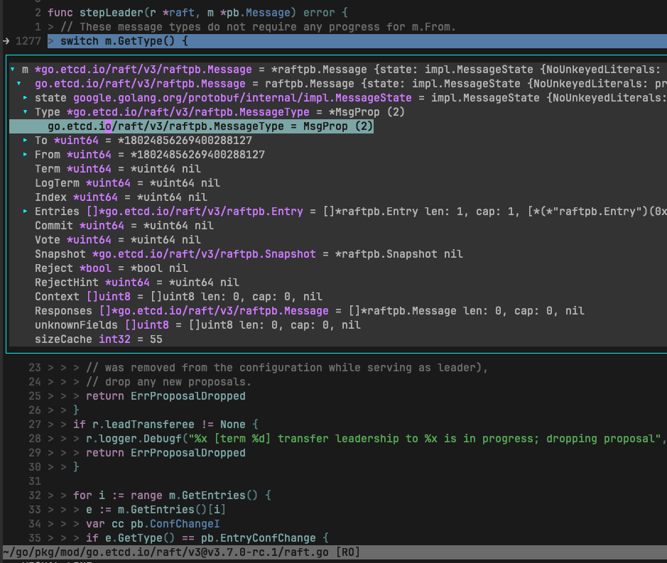
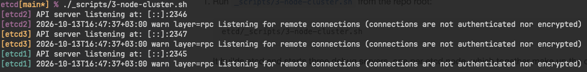
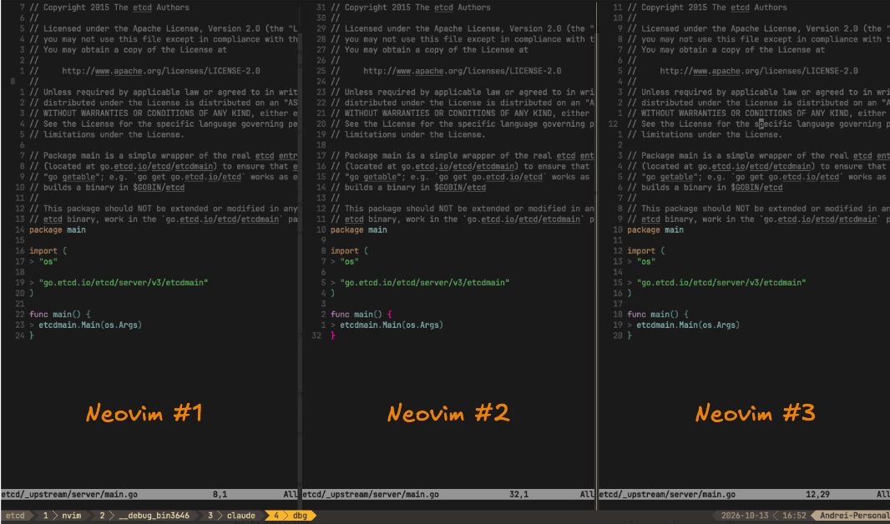

# Debugging a Local Cluster



[]({{VIDEO_URL}})

Other etcd write-ups in this repo assume you can pause a running cluster and step through its code. This one shows how to set that up: three etcd nodes, each running under a debugger, each with its own Neovim instance attached to it.

## Table of Contents

* [Prerequisites](#prerequisites)
* [Debug Client Configuration](#debug-client-configuration)
* [Debugging in Action](#debugging-in-action)
* [Interacting with the Cluster](#interacting-with-the-cluster)
  * [Check the cluster status](#check-the-cluster-status)
  * [Move the leader](#move-the-leader)
  * [Performing a PUT request](#performing-a-put-request)

## Prerequisites

* **This repo, with the etcd submodule and the debugging patches applied.** The patches raise etcd's internal timeouts, so that requests don't fail while a node sits paused at a breakpoint:

  ```bash
  git clone https://github.com/Andrei0872/under-the-hood.git
  cd under-the-hood
  git submodule update --init etcd/_upstream
  git -C etcd/_upstream apply "$PWD"/etcd/_patches/*.patch
  ```

* **[dlv](https://github.com/go-delve/delve)**, the Go debugger. It wraps a single etcd node in a **debug server**: a process that runs etcd and waits for debug clients to connect.

  ```bash
  go install github.com/go-delve/delve/cmd/dlv@latest
  ```

* **A debug client.** This can be dlv's own command line, VS Code, or Neovim. The instructions below use Neovim.
* **Debugging support for Neovim**, which comes from [nvim-dap](https://github.com/mfussenegger/nvim-dap). My setup is in [my dotfiles](https://github.com/Andrei0872/dotfiles/blob/master/nvim/lua/plugins/dap.lua).

## Debug Client Configuration

Since we'll be using Neovim, two things must be configured.

**1. A debug adapter.** This is the bridge between the debug client (Neovim) and a debug server (dlv). For Go, the adapter has two modes. It can start a fresh dlv process on the fly, or it can point Neovim at a dlv server that is already running. We need the second one, because our debug servers are started by a script, outside of Neovim ([source](https://github.com/Andrei0872/dotfiles/blob/5ffb0a645aec8695ce7b10e59c285abc7381a3f7/nvim/after/plugin/dap.lua#L48-L54)):

```lua
if conf.request == "attach" and (conf.mode == "remote" or conf.mode == "exec") then
  local port = conf.port
  callback({
    type = "server",
    port = assert(port, "`connect.port` is required"),
    host = conf.host or "127.0.0.1",
  })
```

When a configuration asks to attach to a remote server, the adapter only needs an address. It hands a Neovim debug client a host and a port and does not launch anything itself.

**2. A debug client configuration.** This is the entry you pick when starting a debugging session. It tells the adapter to attach to a remote server, and asks for the port each time, since every etcd node has its own debug server ([source](https://github.com/Andrei0872/dotfiles/blob/5ffb0a645aec8695ce7b10e59c285abc7381a3f7/nvim/after/plugin/dap.lua#L151-L159)):

```lua
{
  type = "go",
  name = "Attach to debug server",
  request = "attach",
  host = "127.0.0.1",
  port = function()
    return tonumber(vim.fn.input("Port: ", "2345"))
  end,
  mode = "remote",
  cwd = vim.fn.getcwd(),
}
```

Now we are all set up.

## Debugging in Action

We will be debugging a 3-node cluster. The steps are:

1. Run [`_scripts/3-node-cluster.sh`](_scripts/3-node-cluster.sh) from the repo root:

   ```bash
   etcd/_scripts/3-node-cluster.sh
   ```

   It builds etcd and starts three debug servers, one per etcd node, which together make up the cluster.

2. Watch the output. Each line is prefixed with the node it comes from (`[etcd1]`, `[etcd2]`, `[etcd3]`), and each debug server reports the port debug clients should connect to. All of them listen on localhost:

    

   The nodes don't start running yet. Each **debug server pauses its node until a debug client connects** and tells it to continue, so the cluster forms only after all three are attached.

3. Open three terminal panes, each running a Neovim instance:

    

4. Add breakpoints. A good first one is where a node sets up its connection to another peer: [`rafthttp/peer.go#L132`](https://github.com/etcd-io/etcd/blob/5f6496ad4b0a3c92cc99d200095ae8b89fbcbf0b/server/etcdserver/api/rafthttp/peer.go#L132).

5. In each Neovim instance, connect a debug client to one of the debug servers:
    1. Run `:DapContinue`.
    2. Choose the **Attach to debug server** configuration.
    3. Enter the node's debug server port (2345, 2346 or 2347).

## Interacting with the Cluster

The commands below use `etcdctl`, etcd's command-line client. Build it once from the pinned source, then point it at all three nodes:

```bash
(cd etcd/_upstream/etcdctl && go build)
ETCDCTL="etcd/_upstream/etcdctl/etcdctl --endpoints=localhost:2379,localhost:2381,localhost:2383 --command-timeout=30m --dial-timeout=30m --keepalive-time=1h"
```

The long timeouts keep `etcdctl` from giving up while a node is paused at a breakpoint. A command that needs a paused node simply waits until you continue it.

### Check the cluster status

```bash
$ETCDCTL endpoint status -w table
```

This prints one row per node. The `ID` column holds each node's member ID, and `IS LEADER` tells you which node is the current leader.

### Move the leader

This is helpful when exploring leader-specific behaviour, because you can make the node you are already debugging the leader, instead of moving your breakpoints to another Neovim instance.

```bash
$ETCDCTL move-leader <member-id>
```

`<member-id>` is the target node's ID, as shown in the `ID` column of the status table. 

### Performing a PUT request

This puts the previous tips together: we pause the leader at the moment it receives a write.

1. Pick the Neovim instance you want to work in, and make the node it is attached to the leader. Use [Check the cluster status](#check-the-cluster-status) to find that node's ID, then [Move the leader](#move-the-leader) to it. This matters because a breakpoint set in one Neovim instance only applies to the node that instance is attached to.

2. In that instance, add a breakpoint in the leader-only logic that handles a new write. In Raft, a write starts as a *proposal* (`MsgProp`), and the leader handles it in `stepLeader`: [`raft.go#L1294`](https://github.com/etcd-io/raft/blob/v3.7.0-rc.1/raft.go#L1294).

   Raft lives in its own Go module (`go.etcd.io/raft/v3`), so this file is not in `_upstream`. It is in Go's module cache, which you can open directly:

   ```bash
   nvim "$(go env GOMODCACHE)/go.etcd.io/raft/v3@v3.7.0-rc.1/raft.go" +1294
   ```

   Alternatively, jump to it from etcd's code with your editor's *go to definition*.

3. Perform a `put` request:

   ```bash
   $ETCDCTL put /foo 103
   ```

4. The breakpoint should be hit, and the `put` waits until you continue:

