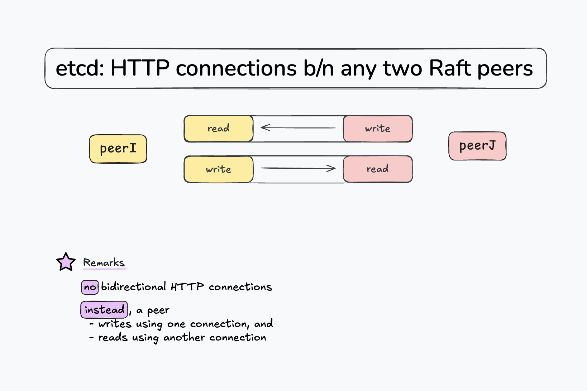

# How Nodes Establish Communication



[](https://youtu.be/Q0qK1c4wjVk)

* [Excalidraw Diagram](https://excalidraw.com/#json=rXZVilQuG6A7YmjH7Y2ms,o2TP0yhEVRenFTjfr98ZjA)

## Setup

* etcd: [`5f6496a`](https://github.com/etcd-io/etcd/tree/5f6496ad4b0a3c92cc99d200095ae8b89fbcbf0b) (`3.8.0-alpha.0`)
* Starting a local 3-node cluster: [`_scripts/3-node-cluster.sh`](_scripts/3-node-cluster.sh) (exemplified in the video)
* Patches: [`0001-req-timeout-30m`](_patches/0001-req-timeout-30m.patch)

## How It Works

**Note**: in reality, more connections are established between any two etcd nodes. We will focus on only two of them, namely those responsible for streaming messages between peers.

Instead of a single bidirectional connection, there are two unidirectional connections between any two peers `peer_I` and `peer_J`:
* one is used by `peer_I` for reading and by `peer_J` for writing, and
* the other is used by `peer_J` for reading and by `peer_I` for writing (the inverse mechanism).

Each peer is aware of the other peers that make up the etcd cluster. This is due to how a node is instantiated with the `--initial-cluster` argument:

```bash

INITIAL_CLUSTER="etcd1=http://localhost:2380,etcd2=http://localhost:2382,etcd3=http://localhost:2384"

# ...

./server/main.go \
    --name=etcd1 \
    --data-dir=/tmp/etcd-data1 \
    --initial-cluster="$INITIAL_CLUSTER" \
    # ...


# Every other node is instantiated with the same `INITIAL_CLUSTER` argument:
./server/main.go \
    --name=etcd2 \
    --data-dir=/tmp/etcd-data2 \
    --initial-cluster="$INITIAL_CLUSTER" \
    # ...
```

Full example at [_scripts/3-node-cluster.sh](https://github.com/Andrei0872/under-the-hood/blob/f42ee403d9df97b1a51f6413eb6158fa2be81b25/etcd/_scripts/3-node-cluster.sh#L7).


Each peer within the cluster:
* spawns a goroutine that is responsible for dialing, and therefore for **reading from other peers**;
* keeps a server running so that it can respond to other peers that dial it; once a connection has been established, it is long-lived and used for all subsequent writes.
